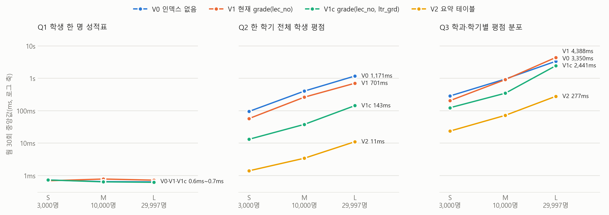

# 성적 조회 성능 실험

성적 데이터가 늘어날 때 어느 조회가 느려지고, 인덱스와 요약 테이블이 각각 얼마나 줄이는지 쟀다. 도구는 `tools/experiment/`, 데이터는 `tools/bulk/` 가 만든다.

## 결론

- **학생 한 명 성적표(Q1, GRD-03)는 손댈 필요가 없다.** 학생 3만 명에서도 1ms 아래다. `enrollment`·`grade` 기본 키가 학번으로 시작해서 그 학생 행만 읽는다.
- **학기 단위 집계(Q2)는 지금 인덱스 `grade(lec_no)` 로 1.7배밖에 안 줄어든다.** 강의로 성적 행을 찾은 뒤 등급(`ltr_grd`)을 읽으려고 행마다 기본 키로 다시 찾아가기 때문이다. 인덱스를 `grade(lec_no, ltr_grd)` 로 바꾸면 다시 찾아갈 일이 없어져 지금보다 4.9배(701 → 143ms) 빠르다. 인덱스는 3MB(18%) 커진다.
- **전체를 훑는 집계(Q3)는 `grade(lec_no)` 인덱스로 줄지 않는다.** 시간의 3분의 1에서 절반이 학생·학기별 GROUP BY 임시 테이블이다. 요약 테이블(V2)이 12배 줄인다.
- **요약 테이블은 가장 빠르지만 앱에는 넣지 않는다.** "평점은 저장하지 않고 조회할 때 계산한다"는 업무 규칙과 충돌하고, 성적이 확정될 때마다 다시 만들어야 한다(D17).
- **최대학점 산정을 SQL 한 문장으로 한 지금 설계가 맞다.** 학생별로 SELECT·INSERT 를 반복하면 16~26배 느리다.



## 방법

| 쿼리 | 내용 | 앱에서 쓰는 곳 |
| --- | --- | --- |
| Q1 | 학생 한 명(20240001)의 전체 성적표, 재수강 표시 포함 | GRD-03 성적 조회와 같은 SQL |
| Q2 | 2026-2 전체 학생의 학기 평점 | 최대학점 산정의 입력 |
| Q3 | 학과·학기별 학기 평점 분포(0.5 단위) | 없음. 통계 화면을 가정한 전체 집계 |

| 비교군 | 내용 |
| --- | --- |
| V0 | `grade(lec_no)` 인덱스를 지운 상태 |
| V1 | 현재 스키마(`ix_grade_lec` = `grade(lec_no)`) |
| V1c | `grade(lec_no, ltr_grd)` 로 바꾼 상태(커버링 인덱스) |
| V2 | V1 + 학생·학기별 학점 합·학점×평점 합 요약 테이블. Q1 의 누적 평점은 재수강 이전 성적을 빼야 해서 요약 테이블로 낼 수 없어 Q2·Q3 만 잰다 |
| V3 | 최대학점 산정: 학생별 SELECT·INSERT 반복 vs `INSERT ... SELECT` 한 문장. 두 결과가 같은지 먼저 확인한다 |

- 쿼리 × 비교군마다 MySQL 을 재시작해 버퍼 풀을 비우고 첫 실행(콜드) 1회, 이어서 30회(웜)를 쟀다. 웜은 중앙값과 p95 를 적는다.
- 시간은 `performance_schema` 의 문장 실행 시간이다. 네트워크와 클라이언트 시간은 들어가지 않는다. 여러 문장을 묶어 재는 V3·쓰기 비용·요약 테이블 생성은 세션 안 `NOW(6)` 차이로 쟀다.
- 실행 계획은 `EXPLAIN ANALYZE` 로 남겼다(`build/experiment/<규모>/explain/`).

| 규모 | 학생 | 강의 | 수강신청 | 성적 |
| --- | ---: | ---: | ---: | ---: |
| S | 3,000 | 약 2,800 | 약 7.6만 | 약 7.6만 |
| M | 10,000 | 9,378 | 약 26만 | 257,745 |
| L | 29,997 | 28,110 | 774,866 | 771,992 |

환경: MySQL 8.4.13, Docker Desktop(CPU 8개, 메모리 7.5GB), 버퍼 풀 512MB, `innodb_flush_method=O_DIRECT`(OS 캐시를 거치지 않아 재시작 직후가 진짜 콜드), 버퍼 풀 덤프·복원 끔. L 규모 `grade` 전체(기본 키 92MB)가 버퍼 풀에 들어가므로 웜 측정은 메모리 안 처리 시간이다.

## 결과

시간 단위는 ms. 중앙값·p95 는 웜 30회.

**Q1 학생 한 명 성적표**

| 비교군 | S 중앙값 | M 중앙값 | L 중앙값 | L p95 | L 콜드 |
| --- | ---: | ---: | ---: | ---: | ---: |
| V0 | 0.7 | 0.6 | 0.6 | 0.8 | 105 |
| V1 | 0.7 | 0.8 | 0.7 | 2.1 | 32 |
| V1c | 0.7 | 0.6 | 0.6 | 1.1 | 29 |

규모가 10배 늘어도 그대로다. 읽는 행이 그 학생의 신청 수(225행)뿐이다. 콜드 값의 차이는 재시작 직후 사전 캐시가 비어 있는 영향이고 인덱스와는 관계없다.

**Q2 한 학기 전체 학생 평점**

| 비교군 | S 중앙값 | M 중앙값 | L 중앙값 | L p95 | L 콜드 | L 읽은 행 |
| --- | ---: | ---: | ---: | ---: | ---: | ---: |
| V0 | 94 | 401 | 1,171 | 1,310 | 2,677 | 1,722,724 |
| V1 | 57 | 260 | 701 | 792 | 2,317 | 155,846 |
| V1c | 13 | 38 | 143 | 209 | 298 | 155,846 |
| V2 | 1.4 | 3.4 | 11 | 15 | 41 | 26,951 |

실행 계획(L 규모)으로 본 이유:

- V0 은 `grade` 77만 행을 기본 키 순서로 전부 읽고, 행마다 강의를 찾아 2026-2 인지 거른다.
- V1 은 2026-2 강의 4,338개에서 출발해 `ix_grade_lec` 으로 성적 행을 찾는다. 읽는 행은 10분의 1로 줄지만, 보조 인덱스에는 `lec_no` 와 기본 키만 있어서 `ltr_grd` 를 읽으려고 14만 9천 번 기본 키를 다시 찾아간다. 이 단계가 491ms 중 대부분이다.
- V1c 는 같은 경로에서 `Covering index lookup` 이 되어 이 단계가 67ms 로 준다. 콜드에서는 차이가 더 커서 2,317 → 298ms 다. 디스크에서 기본 키 페이지를 읽지 않아도 되기 때문이다.

**Q3 학과·학기별 평점 분포**

| 비교군 | S 중앙값 | M 중앙값 | L 중앙값 | L p95 | L 콜드 |
| --- | ---: | ---: | ---: | ---: | ---: |
| V0 | 283 | 945 | 3,350 | 4,802 | 5,483 |
| V1 | 203 | 906 | 4,388 | 5,130 | 6,254 |
| V1c | 123 | 345 | 2,441 | 2,809 | 2,781 |
| V2 | 23 | 71 | 277 | 323 | 411 |

L 에서 V1 이 V0 보다 느리게 나왔지만 `EXPLAIN ANALYZE` 한 번으로는 4,221 대 4,189ms 로 같다. 조인은 V1 이 빠르지만(2.8 → 1.9초) 그 뒤 학생·학기 11만 8천 묶음을 만드는 GROUP BY 임시 테이블이 V0 1.4초, V1 2.3초로 그만큼 늘어 합이 같아진다. 웜 중앙값의 차이는 측정 변동으로 본다(V0 p95 가 중앙값보다 43% 크다).

**V3 최대학점 산정(2026-2 평점으로 다음 학기 최대학점)**

| 규모 | 학생 | 한 문장 | 학생별 반복(문장 수) | 차이 |
| --- | ---: | ---: | ---: | ---: |
| S | 2,690 | 75 | 1,948(5,380) | 26배 |
| M | 9,014 | 272 | 5,793(18,028) | 21배 |
| L | 26,951 | 803 | 13,211(53,902) | 16배 |

반복은 MySQL 컨테이너 안에서 소켓으로 문장을 보낸 시간이라, 앱에서 네트워크를 거치면 차이가 더 커진다.

**비용**

| 항목 | S | M | L |
| --- | ---: | ---: | ---: |
| `grade` 기본 키 크기(MB) | 9.5 | 29.6 | 91.7 |
| `grade(lec_no)` 크기(MB) | 2.5 | 5.5 | 16.6 |
| `grade(lec_no, ltr_grd)` 크기(MB) | 2.5 | 6.5 | 19.6 |
| 성적 전체 다시 넣기, 보조 인덱스 없음 | 957 | 1,606 | 4,485 |
| 성적 전체 다시 넣기, `grade(lec_no)` | 1,261 | 2,748 | 8,787 |
| 성적 전체 다시 넣기, `grade(lec_no, ltr_grd)` | 1,121 | 2,030 | 6,986 |
| 요약 테이블 전체 생성 | 589 | 1,175 | 6,142 |
| 요약 테이블 한 학기만 다시 생성 | 107 | 260 | 1,304 |

보조 인덱스 하나가 대량 쓰기를 1.2~2배 늦춘다. 두 인덱스 사이의 차이는 3회 측정의 변동보다 작아 구분하지 않는다. 앱의 성적 입력은 한 번에 한 강의(수십 행)라 체감할 차이는 아니다.

## 권장

1. `ix_grade_lec` 을 `grade(lec_no, ltr_grd)` 로 바꾸는 것을 제안한다. `lec_no` 로 시작하므로 지금 이 인덱스를 쓰는 강의별 성적 조회는 그대로 쓰고, 학기 단위 집계는 5배 빨라진다. 단점은 인덱스 3MB 와, 등급을 고칠 때마다 이 인덱스도 고쳐진다는 점이다. 스키마 변경이라 세 사람 확인을 거친다.
2. 최대학점 산정은 한 학기에 한 번 도는 일이라 지금(V1)도 L 규모에서 1초 안이다. 1번은 급하지 않고, 통계 화면처럼 학기 단위 집계를 자주 부르는 기능이 생길 때 하면 된다.
3. 요약 테이블은 실험 결과로만 남긴다(D17 (a)). 앱에 넣으려면 업무 규칙과 갱신 시점(성적 확정 때 누가 다시 만드는가)을 먼저 정해야 한다.

## 설계(모듈 A 상세 설계 3-3)와 달라진 점

- 설계는 "`grade` 에 강의번호로 시작하는 인덱스가 없다"를 전제로 V1 을 "인덱스 추가"로 잡았다. 그런데 첫 스키마에 이미 `ix_grade_lec` 이 들어가 있어, V1 을 현재 상태로 두고 인덱스를 지운 V0 을 기준선으로 삼았다. 그러다 보니 V1 의 한계가 보여 V1c 를 더했다.
- 학번을 시드와 같은 8자리(D30)로 맞추면서 입학 연도당 9,999명이 상한이 되어, 규모를 S 3천·M 1만·L 3만 명으로 다시 정했다. 설계의 "M 규모 이상" 기준은 L(성적 77만 행)로 채운다.
- 측정 도구는 D18 (a)대로 Python 으로 SQL 을 직접 실행했다. 외부 패키지 없이 `docker exec` 로 `mysql` 클라이언트를 부르고 시간은 `performance_schema` 에서 읽는다.

## 다시 재기

```
docker run -d --name crs-exp -e MYSQL_ROOT_PASSWORD=<비밀번호> mysql:8.4 --innodb-buffer-pool-size=512M \
    --innodb-buffer-pool-load-at-startup=OFF --innodb-buffer-pool-dump-at-shutdown=OFF --innodb-flush-method=O_DIRECT
python -X utf8 tools/bulk/gen_bulk.py --scale L
python -X utf8 tools/bulk/load_bulk.py --dir build/bulk/L --container crs-exp
python -X utf8 tools/experiment/grade_experiment.py --scale L
python -X utf8 tools/experiment/plot_results.py        # matplotlib 필요
```

규모 하나에 S 3분, M 5분, L 14분 걸렸다(적재 검사 포함).
